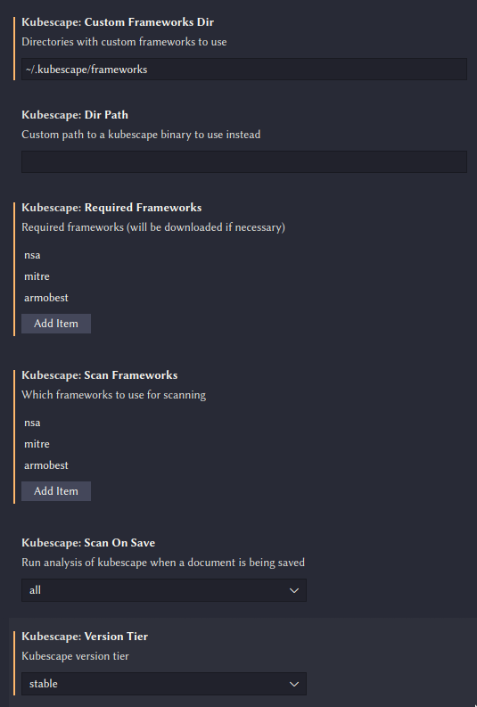

# Kubescape

The [Visual Studio extension](https://www.armosec.io/blog/securing-ci-cd-pipelines-security-gates/?utm_source=github&utm_medium=repository) lets you utilize the power 💪 of [Kubescape](https://github.com/kubescape/kubescape) directly in your favorite text editor.

## ✨ Features

### Scan YAML files and get analysis from Kubescape

YAML files can be scanned using a command.
You can access any of this extension's commands by opening the Command Palette (Ctrl+Shift+P on Linux/Windows and Cmd+Shift+P on Mac), and then typing in the command name.

The default behavior also scans YAML files on save 💾.

Scanning results are marked and can be found in `vscode` 'PROBLEMS' tab. Some information can be viewed when hovering over marked positions.

## 🔒 Requirements

This extension downloads the latest Kubescape version.
However, it is recommended to have Kubescape installed in your path.

## ⚙️ Configuration

Currently the following options can be configured:

### Set custom directory for Kubescape

By default, this extension uses its own Kubescape binary in order to provide
as stable an experience as it can.

If, however, you desire to use a different or maybe a custom Kubescape executable
you can use the option `Dir Path` with a custom directory on your system.

### Scan triggers

For the time being, Kubescape scans can take a while, so it might be unwise to run scans
without a good reason (like a dirty file).
I chose to run a background scan only when a new file is saved on the disk.

To choose between available files to scan on save use the option `Scan On Save`.

Default : scan on save for all supported files.

### Frameworks

[Frameworks](https://www.armosec.io/blog/kubernetes-security-frameworks-and-guidance/?utm_source=github&utm_medium=repository) are collections of controls.
There are some built-in controls that Kubescape can use by default and can be
downloaded locally for an offline scan.
The Kubescape extension for VS code uses this method to increase its scanning
speed.

#### Choosing required frameworks

You can choose which frameworks to use by adding their names into the
`Required Frameworks` configuration. This list only ensures that the frameworks
in it will be downloaded. It does not mark them for scanning usage.

Default : Empty. This means all available frameworks will be downloaded.

#### Overriding the framework directory

The used frameworks are downloaded to the Kubescape directory by default.
You can simply copy / download any desired framework to this directory.
Alternatively, you can use the `Custom Frameworks Dir` configuration to choose a
different directory for frameworks.

Default: Not set. Uses the Kubescape binary directory.

#### Specify frameworks for scanning

To specify which frameworks to use for scanning you can list them in the
`Scan Frameworks` configuration.

The specified frameworks will be used for the scan. If they don't exist, they will
be downloaded automatically.

Default: Not set. Uses frameworks from the framework directory.

### Kubescape Version

By default, I use a version of Kubescape that works well with this extension.

If you wish to use the latest version, you can configure it via
the `Version Tier` option by setting it to 'latest'

## 💼 Marketplace

This extension is available officially at either:

- [Microsoft VScode Extensions Marketplace](https://marketplace.visualstudio.com/items?itemName=kubescape.kubescape)
- [Open VSX Registry](https://open-vsx.org/extension/kubescape/kubescape)
- [Kubescape Github Releases](https://github.com/kubescape/kubescape/releases)

## 🗒️ Release Notes

See [Change Log](./CHANGELOG.md)
